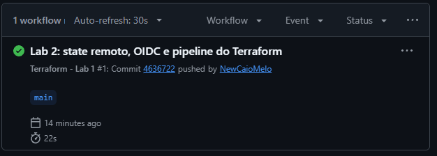
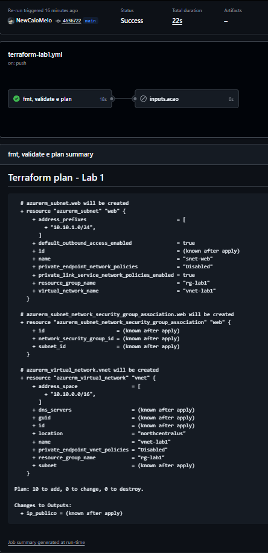
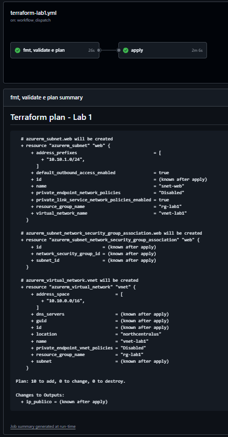
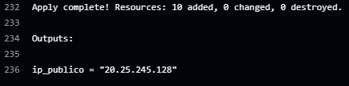
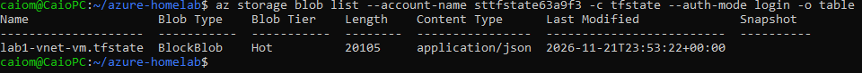
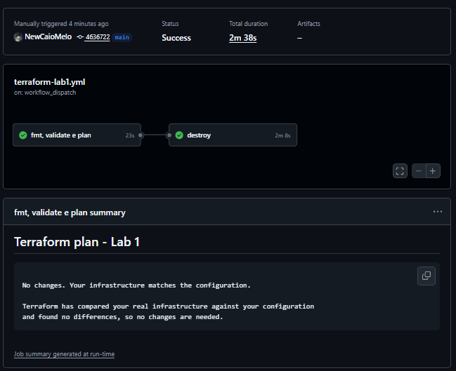

# Lab 2: State remoto + CI/CD com GitHub Actions e OIDC (sem senhas)

Evolução do [Lab 1](../lab1-vnet-vm/): o Terraform deixa de depender do meu computador. O **state** passa a viver num Storage Account do Azure e um **pipeline no GitHub Actions** valida e planeja cada mudança, autenticando no Azure **sem nenhuma senha ou segredo armazenado** (OIDC + Managed Identity).

## Arquitetura

```
 GitHub Actions (push / PR / botão)
        │  1. pede um token OIDC de curta duração ao GitHub
        ▼
 Microsoft Entra ID ── 2. confere o "subject" do token com a
        │                 federated credential da identidade
        ▼
 Managed Identity "id-github-actions"
        │  3. RBAC: Contributor (assinatura) + Storage Blob Data Contributor (state)
        ▼
 Terraform ──► Azure (recursos do Lab 1)
        └────► Storage Account "tfstate" (state remoto, lock por lease, versionamento)
```

## Componentes

| Peça | Arquivo | O que faz |
|---|---|---|
| Backend do state | [`bootstrap/criar-backend.sh`](../bootstrap/criar-backend.sh) | Cria RG, Storage Account (sem acesso público, **sem chave compartilhada**, TLS 1.2, versionamento) e container `tfstate` |
| Identidade do pipeline | [`bootstrap/criar-identidade-github.sh`](../bootstrap/criar-identidade-github.sh) | Cria a User-Assigned Managed Identity, as federated credentials (branch `main`, pull requests, ambiente `lab`), as permissões RBAC e grava os IDs como secrets do repositório |
| Backend no código | [`lab1-vnet-vm/main.tf`](../lab1-vnet-vm/main.tf) | `backend "azurerm"` com `use_azuread_auth = true` (acesso ao state por identidade, não por chave) |
| Pipeline | [`.github/workflows/terraform-lab1.yml`](../.github/workflows/terraform-lab1.yml) | `fmt -check`, `init`, `validate`, `plan` em todo push/PR; `apply`/`destroy` manuais no ambiente `lab` |

## Fluxo do pipeline

| Gatilho | O que roda |
|---|---|
| Push na `main` ou Pull Request que altere o Lab 1 | `terraform fmt -check` → `init` → `validate` → `plan` + resumo do plano na página da execução |
| Botão **Run workflow** → `apply` | Job `plan` e depois `apply` no ambiente `lab` |
| Botão **Run workflow** → `destroy` | Job `plan` e depois `destroy` no ambiente `lab` |

## Decisões de segurança

- **OIDC em vez de client secret:** nenhuma credencial de longa duração existe no GitHub. O token do GitHub vale minutos e só é aceito se vier deste repositório, desta branch/ambiente.
- **Managed Identity em vez de App Registration:** não exige permissão para registrar aplicativos no diretório (tenant institucional).
- **Storage sem shared key:** o state só é acessível via Entra ID + RBAC, nunca por chave de conta.
- **Versionamento de blobs:** qualquer versão anterior do state pode ser recuperada.
- **Dados sensíveis fora do código:** IP autorizado e IDs do Azure ficam em *secrets*; chave SSH pública em *variable*.
- **Trade-off consciente:** a identidade tem `Contributor` na assinatura inteira porque os labs criam Resource Groups. Em produção, o escopo seria restrito a RGs específicos.

## Evidências

| O que | Evidência |
|---|---|
| Pipeline verde no push |  |
| Resumo do plano gerado pelo pipeline |  |
| `apply` pelo GitHub Actions |  |
| Log do apply (10 recursos criados) |  |
| State no Storage Account |  |
| `destroy` pelo GitHub Actions (o plan prévio mostra "No changes": sem drift entre código e Azure) |  |

## Problemas encontrados e soluções

| Problema | Causa | Solução |
|---|---|---|
| `AADSTS700213: No matching federated identity record found` | O GitHub emite o `subject` do token com os IDs imutáveis do dono e do repositório (`repo:dono@ID/repo@ID:ref:...`), diferente do formato clássico `repo:dono/repo:...` | Federated credentials atualizadas para o novo formato; o script de bootstrap agora busca os IDs via `gh api` e monta o subject correto |
| `terraform init -migrate-state` não pediu confirmação | O state local estava vazio (ambiente destruído no Lab 1) | Validado com `terraform plan` lendo do backend remoto |
| `terraform plan` lento na primeira execução | Auto-registro de dezenas de Resource Providers | `resource_provider_registrations = "none"` + registro manual só dos necessários |

