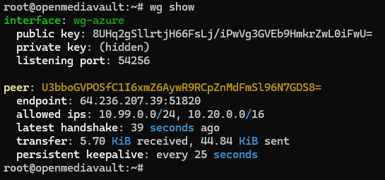
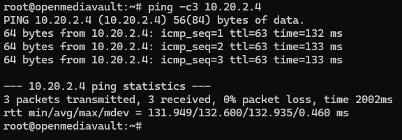
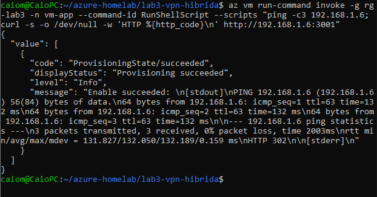
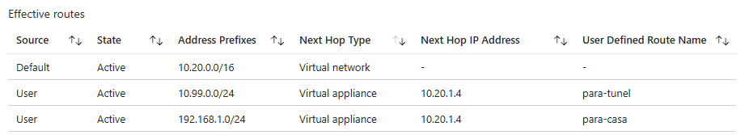

# Lab 3: Rede híbrida homelab ↔ Azure com WireGuard

Conecta o servidor de casa (Debian/OpenMediaVault, rede 192.168.1.0/24) a uma VNet na Azure por um túnel **WireGuard** terminado numa **NVA** (Network Virtual Appliance). A VM de aplicação na Azure **não tem IP público** e mesmo assim conversa com a rede de casa nos dois sentidos.

## Arquitetura

```
  CASA (192.168.1.0/24)                          AZURE  vnet-lab3 10.20.0.0/16
 ┌──────────────────────────┐                 ┌───────────────────────────────────────────┐
 │ servidor OMV 192.168.1.6 │  WireGuard UDP  │ snet-nva 10.20.1.0/24                     │
 │ wg-azure 10.99.0.2 ──────┼─────51820──────►│  vm-nva 10.20.1.4 (wg0 10.99.0.1)         │
 │ Uptime Kuma :3001        │   (internet)    │   IP público + ip_forwarding              │
 └──────────────────────────┘                 │        │                                  │
                                              │        │ UDR rt-app:                      │
                                              │        │ 192.168.1.0/24 → 10.20.1.4       │
                                              │        ▼ 10.99.0.0/24   → 10.20.1.4       │
                                              │ snet-app 10.20.2.0/24                     │
                                              │  vm-app 10.20.2.4 (sem IP público)        │
                                              └───────────────────────────────────────────┘
```

| Recurso | Função |
|---|---|
| `vm-nva` + `nic-nva` | Ubuntu com WireGuard via cloud-init. `ip_forwarding_enabled` na NIC e `net.ipv4.ip_forward=1` no SO |
| `nsg-nva` | UDP 51820 e SSH só do IP de casa; regras explícitas para tráfego encaminhado casa ↔ VNet |
| `rt-app` (UDR) | Rotas para casa e para o túnel com next hop `VirtualAppliance` 10.20.1.4 |
| `vm-app` | Workload privado, sem IP público, acessível só pela VPN |
| `cloud-init-nva.yaml` | Template (`templatefile`) que instala o WireGuard, gera a chave do servidor e sobe o `wg0` |

## Habilidades demonstradas

- Rede híbrida (on-premises ↔ cloud) com VPN site-to-site
- NVA: IP forwarding na NIC e no sistema operacional
- **User Defined Routes** e leitura de rotas efetivas
- NSG para tráfego encaminhado (limitação da service tag `VirtualNetwork`)
- Bootstrap de VM com **cloud-init** e `templatefile` do Terraform
- Troubleshooting de rede com `tcpdump`, `az vm run-command` e `show-effective-route-table`

## Por que WireGuard numa VM e não VPN Gateway?

| | VPN Gateway (Basic/VpnGw1) | NVA WireGuard (este lab) |
|---|---|---|
| Custo | ~US$ 27 a 140/mês + 30 a 45 min para provisionar | 1 VM B2ats_v2, criada em ~2 min |
| Lado de casa | Precisa de IP público e roteador com IPsec | Só o servidor Linux; funciona atrás de NAT/CGNAT (casa inicia a conexão) |
| Gerenciado / SLA | Sim, com alta disponibilidade | Não: eu gerencio a VM, patches e HA |

Para estudo e homelab a NVA ganha. Em produção eu usaria **VPN Gateway** ou **Virtual WAN** (SLA, BGP, HA ativo-ativo), ou uma NVA de mercado em par atrás de um Load Balancer.

## Como executar

```bash
# 1. No servidor de casa: gerar chaves do WireGuard
sudo apt install wireguard-tools
wg genkey | sudo tee /etc/wireguard/casa.key | wg pubkey | sudo tee /etc/wireguard/casa.pub

# 2. Na Azure (WSL)
cd lab3-vpn-hibrida
terraform init
terraform plan -var="meu_ip=$(curl -4 -s ifconfig.me)/32" \
               -var="home_public_key=<conteúdo de casa.pub>" -out=plano
terraform apply plano

# 3. Pegar a chave pública da NVA
az vm run-command invoke -g rg-lab3 -n vm-nva --command-id RunShellScript \
  --scripts "cat /etc/wireguard/server.pub"

# 4. No servidor de casa: criar /etc/wireguard/wg-azure.conf (ver wg-azure.conf.exemplo)
sudo wg-quick up wg-azure
```

## Validação

| Teste | Resultado |
|---|---|
| Handshake do túnel (`wg show`) | ✅ handshake ativo, bytes nos dois sentidos |
| Casa → Azure: `ping 10.20.2.4` do servidor OMV | ✅ 0% de perda, ~132 ms, TTL 63 (um salto: a NVA) |
| Azure → casa: `vm-app` pinga 192.168.1.6 e acessa o Uptime Kuma | ✅ 0% de perda, `HTTP 302` (redirect para o dashboard) |
| Rotas efetivas da `nic-app` | ✅ 192.168.1.0/24 e 10.99.0.0/24 → VirtualAppliance 10.20.1.4 |

**Túnel ativo**



**Casa → VM privada na Azure**



**VM privada na Azure → servidor de casa (ping + Uptime Kuma)**



**Rotas efetivas da NIC da vm-app (UDR)**



## Problemas encontrados e soluções

### 1. Túnel de pé, mas o ping para a vm-app não respondia

O handshake funcionava e o ping para a NVA (10.99.0.1) respondia, mas 10.20.2.4 não. Fui isolando salto por salto:

| Verificação | Resultado |
|---|---|
| `ip route get 10.20.2.4` em casa | sai por `wg-azure` ✅ |
| `sysctl net.ipv4.ip_forward` na NVA | `1` ✅ |
| NVA pinga a vm-app direto | responde ✅ |
| Rotas efetivas da `nic-app` | UDRs ativas ✅ |
| `tcpdump` na NVA | echo request entra em `wg0` e **sai por `eth0`**, sem reply |
| `tcpdump` na vm-app (via `az vm run-command`, já que ela não tem IP público) | **0 pacotes** |

Conclusão: o pacote saía da NVA e era descartado antes de chegar na vm-app, ou seja, pelo **NSG**.

**Causa:** as regras padrão `AllowVnetInBound`/`AllowVnetOutBound` usam a service tag `VirtualNetwork`. Ela inclui o espaço da VNet, VNets pareadas e prefixos aprendidos de um VPN Gateway, mas **não** inclui redes que estão atrás de uma NVA (192.168.1.0/24 e 10.99.0.0/24). O tráfego com origem em casa caía na regra `DenyAll`.

**Solução:** regras explícitas de entrada e saída no `nsg-nva` e no `nsg-app` para os prefixos de casa e do túnel. Depois do apply (`2 to change`, nenhuma VM recriada), o ping passou na hora.

### 2. Sobreposição de faixas de IP

Durante o `tcpdump` apareceu tráfego de 10.99.0.2 para 10.20.168.91. Era o Tailscale do servidor tentando alcançar o IP privado da operadora do meu celular, que caiu dentro do `AllowedIPs` 10.20.0.0/16 do túnel. Na prática isso mostra por que o **planejamento de endereçamento** importa em redes híbridas: as faixas da cloud não podem colidir com nenhuma rede que os clientes on-prem já usam.

### 3. Capacidade de SKU e região

Mesmas restrições dos labs anteriores (assinatura Azure for Students): `northcentralus` + `Standard_B2ats_v2`.

## Limpeza

```bash
# em casa
sudo wg-quick down wg-azure
# no WSL
terraform destroy -var="meu_ip=0.0.0.0/32" -var="home_public_key=<casa.pub>"
```
